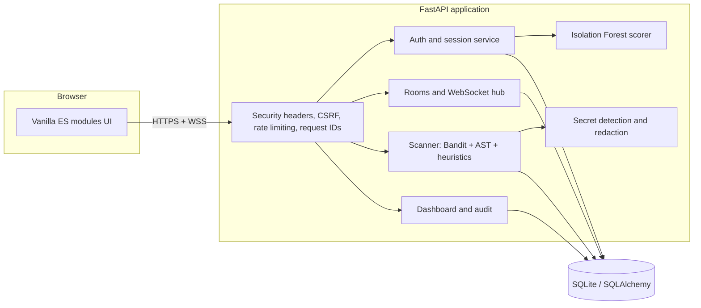

# Code-Shield

[](https://github.com/Harishwaran18/Code-Shield/actions/workflows/ci.yml)
[](https://www.python.org/)
[](#responsible-use)

A secure, real-time collaborative coding workspace with multi-engine vulnerability
scanning, secret detection, and machine-learning session monitoring.

Code-Shield is built for teams that ship fast without leaking credentials or shipping
avoidable vulnerabilities. Every snippet is scanned before it leaves the editor, every
session is scored continuously, and every privileged action is written to an audit trail.

## Security posture

> Code-Shield is designed and maintained to an industry-standard, advanced security grade.
> It combines defence in depth, least privilege, secure defaults, and continuous verification:
> hardened authentication with rotating tokens, strict CSRF and origin enforcement, a
> restrictive Content Security Policy, server-side authorisation on every resource, DLP-grade
> secret detection, sandboxed static analysis, ML-based anomaly scoring, and a tamper-evident
> audit trail. Security is validated on every commit by linting, static analysis, and an
> automated test suite covering authentication, authorisation, injection, and session abuse.

## Features

| Area | What it does |
| --- | --- |
| Real-time collaboration | WebSocket rooms synchronise code, cursors, presence and chat with per-room authorisation. |
| Multi-engine scanning | Bandit (sandboxed), AST rules, language-specific heuristics and pattern-based secret detection. |
| Secret detection (DLP) | AWS keys, GitHub/Slack/Stripe tokens, private keys, JWTs, database URLs and hardcoded credentials, with literal redaction before persistence. |
| ML session monitoring | Isolation Forest scores each authenticated request on velocity, path spread, failed logins, payload size, IP/UA changes and admin activity. |
| Hardened authentication | bcrypt (cost 12), short-lived JWT access tokens, rotating refresh tokens with reuse detection, HttpOnly cookies. |
| Abuse protection | Per-IP rate limiting, per-account lockout, generic authentication errors. |
| Security dashboard | Live risk distribution, active sessions, alerts, scan history and audit log, streamed to admins every two seconds. |
| Audit trail | Authentication, scanning, session and administrative events recorded with actor, target, IP and request ID. |
| Production packaging | Multi-stage-free hardened Dockerfile, read-only container, non-root user, health checks, CI pipeline. |

## Architecture



## Quick start

### Local

```bash
python -m venv .venv && source .venv/bin/activate
pip install -r requirements-dev.txt
cp .env.example .env            # set CS_SECRET_KEY and CS_ADMIN_PASSWORD
python app.py                   # http://127.0.0.1:8000
```

The first start creates the SQLite database, seeds the administrator from
`CS_ADMIN_EMAIL` / `CS_ADMIN_PASSWORD`, and trains the anomaly model into
`CS_MODEL_DIR`. Delete `data/models/anomaly.joblib` to force retraining.

### Docker

```bash
cp .env.example .env
docker compose up --build       # http://127.0.0.1:8000
```

The container runs as a non-root user with a read-only root filesystem, all
capabilities dropped and `no-new-privileges` set. Only `data/` is writable.

## Configuration

Every setting can be supplied as an environment variable with the `CS_` prefix.

| Variable | Default | Purpose |
| --- | --- | --- |
| `CS_SECRET_KEY` | random per boot | JWT signing key. **Set this in production.** |
| `CS_ENVIRONMENT` | `development` | Enables debug behaviour and disables Secure cookies outside production. |
| `CS_ALLOWED_ORIGINS` | empty | Comma-separated public origins for cross-origin state changes. Same-origin is always allowed. |
| `CS_DATABASE_URL` | `sqlite:///./data/codeshield.db` | SQLAlchemy URL. |
| `CS_ADMIN_EMAIL` / `CS_ADMIN_PASSWORD` | `admin@codeshield.dev` / generated | Bootstrap administrator. |
| `CS_ACCESS_TOKEN_MINUTES` | `15` | Access token lifetime. |
| `CS_REFRESH_TOKEN_DAYS` | `7` | Refresh token lifetime. |
| `CS_COOKIE_SECURE` | `true` in production | `Secure` flag on cookies. |
| `CS_RATE_LIMIT_PER_MINUTE` | `240` | General API budget per IP. |
| `CS_AUTH_RATE_LIMIT_PER_MINUTE` | `12` | Authentication budget per IP. |
| `CS_LOGIN_MAX_FAILURES` | `5` | Failures before account lockout. |
| `CS_LOGIN_LOCKOUT_MINUTES` | `15` | Lockout duration. |
| `CS_MAX_CODE_BYTES` | `200000` | Maximum snippet size. |
| `CS_SCAN_TIMEOUT_SECONDS` | `12` | Bandit timeout. |
| `CS_ANOMALY_CONTAMINATION` | `0.03` | Expected anomaly rate in the baseline. |

## API

| Method | Path | Description |
| --- | --- | --- |
| `GET` | `/api/health` | Liveness, database and ML engine status. |
| `GET` | `/api/auth/csrf` | Issue a CSRF token. |
| `POST` | `/api/auth/register` | Create an account (first account becomes admin when no admin is seeded). |
| `POST` | `/api/auth/login` | Authenticate; sets access and refresh cookies. |
| `POST` | `/api/auth/refresh` | Rotate the refresh token. Reuse revokes the session. |
| `POST` | `/api/auth/logout` | Revoke the current session. |
| `GET` | `/api/auth/me` | Current identity and session risk. |
| `GET` | `/api/auth/sessions` | List your active sessions. |
| `POST` | `/api/auth/sessions/{id}/terminate` | Revoke one of your sessions. |
| `POST` | `/api/auth/password` | Change password and revoke other sessions. |
| `GET`/`POST` | `/api/rooms` | List or create rooms. |
| `GET`/`DELETE` | `/api/rooms/{id}` | Read or delete a room (owner only). |
| `PUT` | `/api/rooms/{id}/code` | Save shared code. |
| `POST` | `/api/rooms/{id}/join` / `leave` | Membership management. |
| `GET` | `/api/rooms/{id}/members` | Room members. |
| `POST` | `/api/scans` | Scan a snippet (optionally bound to a room). |
| `GET` | `/api/scans` / `/api/scans/{id}` | Scan history and detail. |
| `DELETE` | `/api/scans/{id}` | Delete your scan (admins may delete any). |
| `GET` | `/api/dashboard` | Aggregated security metrics (members see their own scope). |
| `POST` | `/api/sessions/{id}/verify` / `terminate` | Administrative session actions. |
| `GET`/`POST` | `/api/alerts`, `/api/alerts/{id}/ack` | Alert queue and acknowledgement. |
| `GET` | `/api/audit` | Audit trail (admin only). |
| `WS` | `/ws/rooms/{id}` | Room snapshot, edits, presence, chat, ping. |
| `WS` | `/ws/dashboard` | Live dashboard payload every two seconds (admin only). |

Interactive documentation is served at `/api/docs` and the schema at `/api/openapi.json`.

## Security controls

- **Authentication** — bcrypt hashing with a cost factor of 12, 12-character password
  policy with character-class requirements, account lockout, and generic error messages
  that do not disclose whether an account exists.
- **Sessions** — short-lived access tokens, rotating refresh tokens with reuse detection,
  token revocation, `HttpOnly` + `SameSite` cookies, and `Secure` cookies in production.
- **CSRF** — double-submit token plus `Origin` verification on every state-changing
  request, including WebSocket upgrades.
- **Authorisation** — every room, scan, session and alert is scoped server-side; role
  checks are centralised in dependencies and never trusted from the client.
- **Headers** — strict Content Security Policy, `X-Frame-Options: DENY`, `nosniff`,
  `no-referrer`, permissions policy, and request IDs for correlation.
- **Input handling** — Pydantic validation on every endpoint, bounded snippet size,
  parameterised SQLAlchemy queries, and no dynamic evaluation of user code.
- **Secret hygiene** — detected secrets are redacted before storage and never echoed in
  API responses, logs or error messages.
- **Abuse resistance** — per-IP rate limiting with `Retry-After`, per-account lockout and
  payload ceilings.
- **Observability** — structured JSON logs, audit trail, anomaly alerts, and health
  endpoints.

See [SECURITY.md](SECURITY.md) for the threat model, reporting process and deployment
hardening checklist.

## Quality gates

```bash
ruff check server tests app.py     # lint
bandit -r server -ll               # static security analysis
pytest                             # 54 tests
for f in web/js/*.js; do node --check "$f"; done
```

The test suite exercises the real application: authentication and token rotation,
lockout, CSRF and origin enforcement, RBAC, scan detection and redaction, room
permissions, dashboard aggregation, session administration and both WebSocket
channels.

## Project layout

```
app.py                  Entrypoint (uvicorn)
server/
  main.py               App factory, middleware, error handling, static hosting
  config.py             Typed settings (CS_* environment)
  db.py                 SQLAlchemy engine, sessions, pragmas
  models.py             Users, sessions, rooms, scans, alerts, audit
  deps.py               Authentication, authorisation, risk scoring
  schemas.py            Request and response models
  security/             Passwords, tokens, CSRF, headers, secrets, anomaly, risk
  services/scanner.py   Bandit + AST + heuristics + DLP pipeline
  routers/              auth, rooms, scans, dashboard, websocket
web/                    Static frontend (HTML, CSS, ES modules)
tests/                  Pytest suite
legacy/                 Original prototype scripts (not used at runtime)
```

## Responsible use

Code-Shield is intended for authorised security testing, education and defensive
engineering. Only scan code you own or have explicit permission to analyse. Do not
deploy it as a public service without completing the hardening checklist in
[SECURITY.md](SECURITY.md).
